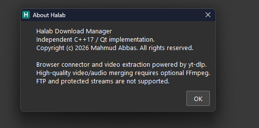

# Halab Download Manager

برنامج لإدارة التنزيلات على Windows، مطوّر باستخدام **C++17 وQt 6**، مع إضافة لمتصفحات Chromium وموصل اتصال أصلي بين الإضافة والبرنامج.

**[English](README.md)** · [تحميل البرنامج](https://github.com/mahmudabbas0/HalabDownloadManager/releases/latest) · [دليل البناء](docs/BUILDING.md) · [تفاصيل إضافة المتصفح](docs/BROWSER.md)

حقوق الملكية © 2026 **Mahmud Abbas**. جميع الحقوق محفوظة.



## المميزات

- تنزيل HTTP وHTTPS باستخدام أجزاء متوازية، مع الإيقاف المؤقت والاستكمال وحفظ الأجزاء على القرص.
- اكتشاف دعم Range واستخدام ETag أو Last-Modified عند توفرهما، والتحقق من حدود الأجزاء عند الاستكمال.
- قوائم انتظار، وجدولة التنزيلات، وتحديد السرعة، وإعدادات الوكيل وإعادة المحاولة.
- اكتشاف اسم الملف وصيغته من ترويسات الخادم وإعادة التوجيه ونوع المحتوى وتوقيع الملف، مثل ZIP وMP3.
- دعم العربية والإنجليزية والتركية، مع اتجاه واجهة من اليمين إلى اليسار للعربية.
- التشغيل مع Windows، وأيقونة بجانب الساعة، واستمرار العمل بعد إغلاق النافذة.
- رسالة تأكيد للحذف مع خيار **«حذف الملفات المحمّلة من القرص أيضًا»** غير محدد افتراضيًا.
- اعتراض تنزيلات المتصفح بإضافة Manifest V3؛ **Alt + النقر** يسمح بالتنزيل بالمتصفح لهذه المرة.
- زر عائم للفيديو واختيار الصيغ المتاحة للمقاطع العامة المدعومة، باستخدام أدوات فيديو اختيارية.

## التحميل والتثبيت

افتح صفحة **[Releases](https://github.com/mahmudabbas0/HalabDownloadManager/releases/latest)** وحمّل الملفات المناسبة:

| الملف | وظيفته |
| --- | --- |
| `HalabDownloadManager-1.0.3-Setup.exe` | مثبّت البرنامج لنظام Windows x64 |
| `HalabDownloadManager-1.0.3-BrowserExtension.zip` | إضافة غير مضغوطة للاستخدام بوضع المطوّر بعد فك ZIP |
| `HalabDownloadManager-1.0.3-BrowserExtension.crx` | حزمة إضافة بتوقيع CRX3 |
| `SHA256SUMS.txt` | بصمات التحقق من سلامة ملفات الإصدار |

1. شغّل المثبّت واتبع **التالي ← تثبيت ← إنهاء**. سيطلب صلاحيات المسؤول.
2. المسار الافتراضي هو `C:\Program Files (x86)\Halab Download Manager`.
3. دعم الفيديو خيار في المثبّت، ويحتاج الإنترنت لتنزيل المكوّنات الرسمية والتحقق من بصماتها.
4. ثبّت إضافة المتصفح بالطريقة التالية.

المثبّت حاليًا **غير موقّع بشهادة ناشر Windows**. توقيع CRX3 يخص حزمة الإضافة؛ ولا يعني وجود شهادة Windows أو قبول الإضافة في Chrome Web Store.

## إضافة المتصفح باستخدام وضع المطوّر

1. حمّل ملف **BrowserExtension.zip** من الإصدار وفك ضغطه في مجلد ثابت. لا تحدد ملف ZIP نفسه عند التحميل.
2. افتح `chrome://extensions` في Chrome، أو `edge://extensions` في Edge.
3. فعّل **Developer mode / وضع المطوّر**.
4. اضغط **Load unpacked / تحميل إضافة غير مضغوطة**.
5. اختر المجلد الذي يحتوي على `manifest.json` مباشرةً.
6. احتفظ بالمجلد ولا تنقله بعد إضافته، وأبقِ وضع المطوّر مفعّلًا.
7. افتح Halab، ثم افتح أيقونة الإضافة واضغط **Check connection / فحص الاتصال**، مع تفعيل تحويل التنزيلات تلقائيًا.

إذا استنسخت المستودع، يمكنك اختيار مجلد **`browser-extension/`** مباشرة بدل تنزيل ZIP.

**Chrome على Windows يمنع عادةً تفعيل ملفات CRX المثبّتة من خارج متجره.** وجود CRX في الإصدار لا يوفّر تثبيتًا صامتًا أو موافقة المتجر؛ طريقة الاستخدام المحلي المعتمدة هنا هي وضع المطوّر. راجع [دليل المتصفح](docs/BROWSER.md).

### الاستخدام اليومي

- أضف رابطًا من **Add URL**، أو اضغط رابط تنزيل في المتصفح.
- اضغط **Alt أثناء النقر** لتجاوز البرنامج وتنزيل ذلك الملف بالمتصفح مرة واحدة.
- إغلاق النافذة يُبقي البرنامج يعمل في الخلفية؛ اختر **خروج** من قائمة الأيقونة بجانب الساعة لإنهائه.
- إذا تعذّر الاتصال بالبرنامج، تحتفظ الإضافة بالرابط لإعادة المحاولة من **Retry pending**، دون رجوع تلقائي إلى التنزيل بالمتصفح.
- عطّل التقاط التنزيلات في أي مدير آخر، مثل IDM، أثناء تجربة Halab لتجنب التعارض.

## لغات البرمجة والتقنيات

| الجزء | التقنية |
| --- | --- |
| الواجهة ومحرك التنزيل | C++17 مع Qt Widgets وQt Network |
| موصل المتصفح | C++17 وQt Core/Network وNative Messaging |
| الإضافة | JavaScript وHTML وCSS وManifest V3 وdeclarativeNetRequest |
| الترجمة | ملفات JSON للعربية والإنجليزية والتركية |
| البناء | CMake وNinja؛ جُرّب باستخدام Qt 6.10.1 وMinGW 13.1 x64 |
| المثبّت | Inno Setup 6 وPascal Script |
| الاختبارات والتغليف | Python 3.10 أو أحدث وNode.js 24.x |
| الفيديو الاختياري | yt-dlp وFFmpeg وNode.js |

## البناء من المصدر

يشرح **[دليل البناء الكامل](docs/BUILDING.md)** المتطلبات والخيارات. البيئة المجرّبة هي Windows مع Qt 6.10.1 MinGW x64، والمترجم الموافق MinGW 13.1، إضافة إلى CMake وNinja وPython 3.10+ وNode.js 24.x.

نفّذ من PowerShell:

```powershell
git clone https://github.com/mahmudabbas0/HalabDownloadManager.git
cd HalabDownloadManager
.\scripts\build.ps1 -Python python
```

ستجد البرنامج مع مكتبات التشغيل في:

```text
build\package\App\HalabDownloadManager.exe
```

لإعادة بناء المثبّت، ثبّت Inno Setup 6 وحمّل حزمة CRX المطابقة للإصدار أولًا، ثم نفّذ:

```powershell
.\scripts\build.ps1 -CreateInstaller -BrowserCrx C:\Downloads\HalabDownloadManager-1.0.3-BrowserExtension.crx
```

تظهر حزم النشر في `dist\`. سكربتات التطوير لا تُثبَّت مع البرنامج. توقيع إضافة معدّلة يتطلب مفتاحًا خاصًا خارج المستودع ومعرّف إضافة متوافقًا؛ التفاصيل في [BUILDING.md](docs/BUILDING.md#extension-packaging-and-signing).

## التعديل على المشروع

| المجلد | محتوياته |
| --- | --- |
| `src/` | محرك التنزيل والواجهة وموصل المتصفح والأيقونة وملفات الترجمة |
| `browser-extension/` | اعتراض التنزيلات وAlt والنافذة المنبثقة وزر الفيديو وملف manifest |
| `installer/` | معالج التثبيت والتشغيل التلقائي وتسجيل الموصل |
| `scripts/` | أدوات البناء والاختبار وتغليف الإضافة |
| `tests/` | اختبارات الاستكمال وسلامة الملفات والواجهة وتكامل المتصفح |
| `third-party/` | تراخيص المكتبات والمكوّنات الخارجية |
| `docs/` | أدلة البناء والمتصفح والخصوصية والتحقق |

الواجهة مكتوبة داخل C++، ولا توجد ملفات Qt Designer بصيغة `.ui`. عدّل `src/languages.json` لتغيير النصوص المترجمة. أعد البناء بعد تعديل C++، واضغط إعادة تحميل الإضافة **⟳** بعد تعديل JavaScript أو manifest.

لتشغيل الاختبارات بعد البناء:

```powershell
.\scripts\test.ps1
```

راجع [دليل المساهمة](CONTRIBUTING.md) و[نطاق الاختبارات](docs/VALIDATION.md).

## نطاق الدعم والقيود

الاستكمال يعتمد على دعم الخادم وصلاحية الرابط وهوية الملف. الخوادم التي ترفض Range، والروابط الموقّعة المنتهية، والملفات التي تغيّرت لا يمكن دائمًا استكمالها بأمان. التحقق من تداخل الأجزاء عند غياب معرّف قوي يساعد على اكتشاف التغيّر، لكنه لا يثبت أن كل بايت سابق على الخادم بقي مطابقًا.

تُعترض روابط الصيغ المعروفة قبل طلب المتصفح للملف. الرابط بلا امتداد قد يحتاج قراءة الترويسات أولًا؛ تُحوّل الردود المطابقة قبل بدء مدير تنزيل المتصفح. لبعض تنزيلات HTTP الأخرى توجد آلية إلغاء فوري وتنظيف للعنصر الملتقط فقط. روابط Blob وData، وجلسات الدخول، وتنزيلات POST، والمحتوى المحمي وDRM، وجميع المواقع الممكنة ليست مدعومة بصورة شاملة.

المشروع تطبيق مستقل؛ لا يحتوي على ملفات IDM التنفيذية أو شيفرته الخاصة، ولا يدّعي تطابقًا كاملًا معه أو ارتباطًا بمطوّريه.

## الخصوصية والترخيص

لا يستخدم Halab خادم تنزيل تابعًا للمطوّر ولا خدمة تحليلات. تُحفَظ الإعدادات وقائمة التنزيلات محليًا؛ وتحتفظ الإضافة بإعداد الالتقاط والتجاوز المؤقت والروابط المعلّقة والأخطاء. التفاصيل في [سياسة الخصوصية](docs/PRIVACY.md).

الشيفرة والأيقونات والمثبّت الأصليون **حقوق Mahmud Abbas © 2026، وجميع الحقوق محفوظة**. إتاحة المصدر لا تعني تلقائيًا ترخيصًا مفتوح المصدر. يسمح [LICENSE](LICENSE) بالاطلاع وإعادة البناء وفق شروطه؛ ويحتاج التعديل أو إعادة التوزيع إذن المالك كما هو موضح فيه.

تبقى حقوق Qt وMinGW وNode.js وyt-dlp وFFmpeg لأصحابها وفق تراخيصها. راجع [إشعارات المكوّنات الخارجية](THIRD-PARTY-NOTICES.md).
