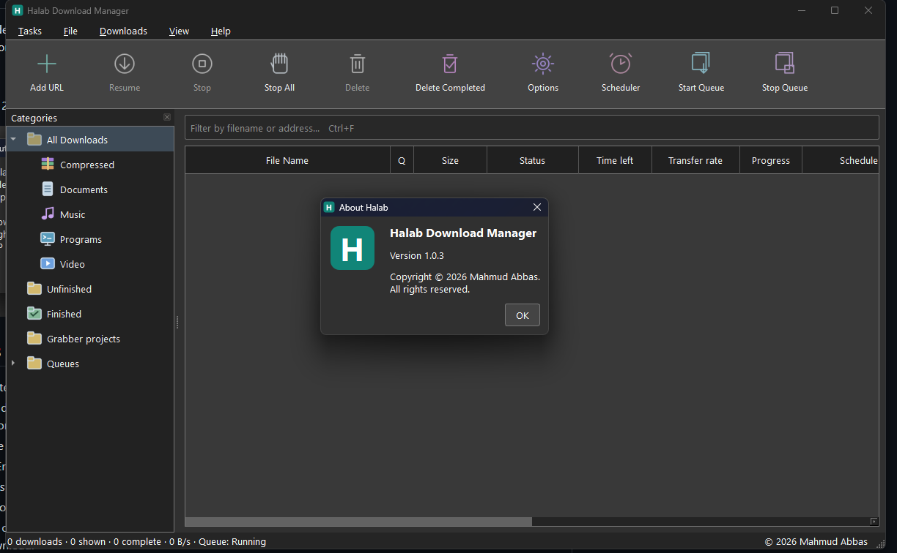

# Halab Download Manager

A Windows desktop download manager built with **C++17 and Qt 6**, with a Chromium browser extension and a native messaging connector.

**[العربية](README.ar.md)** · [Download](https://github.com/mahmudabbas0/HalabDownloadManager/releases/latest) · [Build guide](docs/BUILDING.md) · [Browser setup](docs/BROWSER.md) · [Changelog](CHANGELOG.md)

Copyright © 2026 **Mahmud Abbas**. All rights reserved.



## Features

- Segmented HTTP/HTTPS downloads, pause/resume, durable partial files, queues and scheduling.
- Resume discovery using HTTP Range, strong ETag or Last-Modified when available, overlap verification, and protection against changed server content.
- Filename detection from server headers, redirects, MIME types and file signatures, including ZIP and MP3.
- Arabic, English and Turkish interfaces; Arabic right-to-left layout.
- Windows startup integration, a system-tray icon, and background downloads after closing the main window.
- Delete confirmation with an **unchecked-by-default** option to also delete the downloaded file from disk.
- Browser capture using Manifest V3 declarative network rules and native messaging. **Alt + click** bypasses Halab for one download.
- A floating video button and format selection for supported public videos, using optional upstream video tools.

## Download and install

Open **[Releases](https://github.com/mahmudabbas0/HalabDownloadManager/releases/latest)** and download:

| Asset | Purpose |
| --- | --- |
| `HalabDownloadManager-1.0.3-Setup.exe` | Windows x64 installer |
| `HalabDownloadManager-1.0.3-BrowserExtension.zip` | Unpacked extension for developer mode — recommended for local use |
| `HalabDownloadManager-1.0.3-BrowserExtension.crx` | Signed CRX3 extension package |
| `SHA256SUMS.txt` | SHA-256 checksums for the release assets |

1. Run the installer and follow **Next → Install → Finish**. Administrator permission is required.
2. The default destination is `C:\Program Files (x86)\Halab Download Manager`.
3. Video support is an optional installer task and needs an Internet connection to download verified upstream components.
4. Install the browser extension separately using the steps below.

The executable is currently **not signed with a Windows publisher certificate**. The CRX3 signature is an extension package signature; it is not a Windows code-signing certificate or Chrome Web Store approval.

## Add the extension using developer mode

1. Download the **BrowserExtension.zip** release asset and extract it to a permanent folder. Do not select the ZIP file itself.
2. Open `chrome://extensions` in Chrome or `edge://extensions` in Edge.
3. Enable **Developer mode**.
4. Select **Load unpacked** and choose the extracted directory containing `manifest.json`.
5. Keep that directory in place and keep developer mode enabled.
6. Open Halab, click its browser-extension icon and select **Check connection**. Leave automatic capture enabled.

When using a source checkout, load the repository's **`browser-extension/`** directory directly.

**Windows Chrome generally blocks manually installed CRX files outside its store.** A CRX release asset does not provide silent installation or store approval. Developer-mode installation is the supported local method here. See [browser integration details](docs/BROWSER.md).

### Everyday use

- Use **Add URL** or click a downloadable link in your browser.
- Hold **Alt while clicking** to download that item with the browser instead.
- Closing the window keeps Halab running in the system tray. Use **Exit** from the tray menu to stop it.
- If the desktop connector is unavailable, the extension retains the URL for **Retry pending**; it does not silently fall back to a browser download.
- Disable capture in other download managers, including IDM, while testing Halab to avoid competing interception.

## Languages and technologies

| Part | Technology |
| --- | --- |
| Desktop UI and HTTP engine | C++17, Qt 6 Widgets and Network |
| Browser/native connector | C++17, Qt Core/Network, native messaging |
| Browser extension | JavaScript, HTML, CSS, Manifest V3, declarativeNetRequest |
| Interface translations | JSON catalogs: Arabic, English, Turkish |
| Build | CMake and Ninja; tested with Qt 6.10.1 / MinGW 13.1 x64 |
| Windows installer | Inno Setup 6 / Pascal Script |
| Tests and extension packaging | Python 3.10+ and Node.js 24.x |
| Optional video support | yt-dlp, FFmpeg and Node.js |

## Build from source

See **[the complete build guide](docs/BUILDING.md)** for prerequisites and packaging. The tested Windows configuration uses Qt 6.10.1 MinGW x64, its matching MinGW 13.1 compiler, CMake, Ninja, Python 3.10+, and Node.js 24.x.

```powershell
git clone https://github.com/mahmudabbas0/HalabDownloadManager.git
cd HalabDownloadManager
.\scripts\build.ps1 -Python python
```

The deployed application is written to `build\package\App\HalabDownloadManager.exe`. The script packages the Qt/compiler runtime and Node.js; it does not add development scripts to the installed application.

To rebuild the installer, download the matching signed CRX release asset first, install Inno Setup 6, then run:

```powershell
.\scripts\build.ps1 -CreateInstaller -BrowserCrx C:\Downloads\HalabDownloadManager-1.0.3-BrowserExtension.crx
```

Output goes to `dist\`. Signing a modified CRX requires your own private signing key and a consistent extension identity; see [BUILDING.md](docs/BUILDING.md#extension-packaging-and-signing).

## Modify the project

| Directory | What to edit |
| --- | --- |
| `src/` | Download engine, desktop UI, native host, resources and translation catalogs |
| `browser-extension/` | Download interception, Alt bypass, popup, video overlay and extension manifest |
| `installer/` | Installer wizard, startup registration and native-host manifest |
| `scripts/` | Reproducible build, test and extension packaging helpers |
| `tests/` | HTTP/resume, file integrity, UI lifecycle and browser integration tests |
| `third-party/` | Dependency license notices |
| `docs/` | Build, browser, privacy and validation documentation |

The UI is constructed in C++; there are no Qt Designer `.ui` files. Edit `src/languages.json` for interface strings. Rebuild after changing C++; reload the unpacked extension after changing its JavaScript or manifest.

Run the checks after a build:

```powershell
.\scripts\test.ps1
```

See [CONTRIBUTING.md](CONTRIBUTING.md) for the editing workflow and [validation notes](docs/VALIDATION.md) for test scope.

## Scope and limitations

Resume depends on the source server and resource identity. Servers that reject byte ranges, expired signed URLs and changed files cannot always be resumed safely. Overlap checks without a strong validator are useful consistency checks, not proof that every earlier remote byte is unchanged.

Known file URLs are intercepted before a browser request. An extensionless link can require a response-header request to identify an attachment; matching responses are redirected before the browser download manager starts. Other supported HTTP downloads use immediate cancellation and scoped cleanup as a fallback. Blob/data URLs, authenticated sessions, POST downloads, DRM/protected media and every possible website are **not universally supported**.

This is an independently written application. No IDM binary or proprietary IDM source code is included, and this project does not claim complete IDM compatibility or affiliation with its developers.

## Privacy, license and attribution

Halab has no developer-operated download server or analytics service. The application stores queue/settings locally; the extension stores capture settings, temporary bypasses and pending URLs/errors. Read [PRIVACY.md](docs/PRIVACY.md) for details.

The original Halab code, artwork and installer are **Copyright © 2026 Mahmud Abbas, all rights reserved**. This is a **source-available** project under [LICENSE](LICENSE), not an automatic grant of an open-source license. Inspection and rebuilding are covered by the supplied terms; modification/redistribution requires the owner's permission as described there.

Qt, MinGW, Node.js, yt-dlp and FFmpeg retain their respective licenses and copyrights. See [third-party notices](THIRD-PARTY-NOTICES.md).
